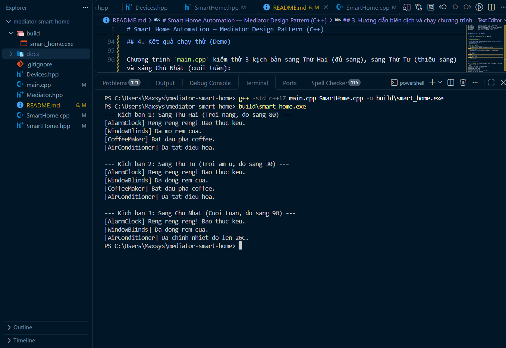

# Smart Home Automation — Mediator Design Pattern (C++)

Dự án minh họa cách áp dụng **Mediator Design Pattern** (mẫu thiết kế thuộc nhóm Behavioral) bằng ngôn ngữ **C++17** thông qua bài toán tự động hóa nhà thông minh buổi sáng. Thay vì để các thiết bị IoT giao tiếp trực tiếp với nhau tạo thành mạng lưới phụ thuộc chằng chịt ($O(N^2)$), toàn bộ luồng sự kiện và quyết định điều phối được tập trung tại bộ điều khiển trung tâm `SmartHome`.

---

## 1. Bài toán & Kịch bản hoạt động

Hệ thống gồm **5 thiết bị độc lập**:

- **`AlarmClock`**: Đồng hồ báo thức (thiết bị phát sự kiện).
- **`LightSensor`**: Cảm biến ánh sáng ngoài trời (cung cấp mức độ sáng từ `0` đến `100`).
- **`WindowBlinds`**: Rèm cửa tự động (đóng/mở).
- **`CoffeeMaker`**: Máy pha cà phê tự động.
- **`AirConditioner`**: Điều hòa nhiệt độ (tắt hoặc điều chỉnh nhiệt độ).

### Quy tắc điều phối tại `SmartHome`

Khi đồng hồ báo thức reo (`Event::AlarmRang`) lúc 6:00 sáng:

1. **Ngày đi học / đi làm (Thứ Hai – Thứ Sáu):**
   - Đọc dữ liệu từ `LightSensor`: nếu độ sáng $\ge 50$ (trời đã sáng) thì mở `WindowBlinds` để đón ánh sáng tự nhiên; ngược lại ($< 50$) thì đóng kín rèm.
   - Kích hoạt `CoffeeMaker` để pha cà phê buổi sáng.
   - Tắt `AirConditioner` để tiết kiệm điện trước khi người dùng ra khỏi nhà.
2. **Ngày cuối tuần (Thứ Bảy & Chủ Nhật):**
   - Luôn đóng kín `WindowBlinds` bất kể độ sáng bên ngoài để tránh chói nắng.
   - Không tự động bật sớm `CoffeeMaker`.
   - Điều chỉnh `AirConditioner` về mức `26°C` để duy trì không gian nghỉ ngơi thoải mái.

---

## 2. Kiến trúc Mediator & Cấu trúc thư mục

| Thành phần trong Mediator Pattern | Lớp tương ứng trong dự án                                                                    | Vai trò                                                                                  |
| :-------------------------------- | :------------------------------------------------------------------------------------------- | :--------------------------------------------------------------------------------------- |
| **Mediator (Interface)**          | `Mediator` (`Mediator.hpp`)                                                                  | Khai báo phương thức giao tiếp thuần ảo `notify(Device*, Event)`                         |
| **Colleague (Base Class)**        | `Device` (`Mediator.hpp`)                                                                    | Lớp cơ sở lưu trữ con trỏ `mediator_` và phương thức `setMediator()`                     |
| **Concrete Colleagues**           | `AlarmClock`, `LightSensor`, `WindowBlinds`, `CoffeeMaker`, `AirConditioner` (`Devices.hpp`) | Các thiết bị độc lập, không giữ tham chiếu chéo lẫn nhau                                 |
| **Concrete Mediator**             | `SmartHome` (`SmartHome.hpp`, `SmartHome.cpp`)                                               | Nắm giữ con trỏ tới 5 thiết bị, xử lý ngữ cảnh ngày (`DayOfWeek`) và điều phối hành động |

```text
mediator-smart-home/
├── build/                  # Thư mục chứa file thực thi sau khi biên dịch (được bỏ qua bởi .gitignore)
├── docs/
│   └── ket-qua-demo.png    # Ảnh chụp màn hình kết quả chạy thử nghiệm
├── .gitignore              # Loại trừ file thực thi (*.exe) và thư mục build/
├── Mediator.hpp            # Định nghĩa enum Event, interface Mediator và lớp cơ sở Device
├── Devices.hpp             # Cài đặt 5 lớp thiết bị IoT độc lập
├── SmartHome.hpp           # Khai báo enum DayOfWeek và lớp điều phối trung tâm SmartHome
├── SmartHome.cpp           # Cài đặt logic điều phối chi tiết trong hàm notify()
├── main.cpp                # Chương trình chính mô phỏng 3 kịch bản kiểm thử
└── README.md               # Tài liệu mô tả và hướng dẫn sử dụng dự án
```

---

## 3. Hướng dẫn biên dịch và chạy chương trình

### Yêu cầu môi trường

- Trình biên dịch hỗ trợ **C++17** trở lên (`g++` / MinGW-w64).

### Các bước thực hiện

1. **Clone repository về máy:**

   ```bash
   git clone [https://github.com/ben-pham29/mediator-smart-home.git](https://github.com/ben-pham29/mediator-smart-home.git)
   cd mediator-smart-home
   ```

2. **Biên dịch mã nguồn:**
   - Trên Windows (`cmd` / PowerShell):
     ```cmd
     g++ -std=c++17 main.cpp SmartHome.cpp -o build\smart_home.exe
     ```
   - Trên Linux / macOS:
     ```bash
     mkdir -p build && g++ -std=c++17 main.cpp SmartHome.cpp -o build/smart_home
     ```

3. **Chạy chương trình:**
   - Trên Windows:
     ```cmd
     build\smart_home.exe
     ```
   - Trên Linux / macOS:
     ```bash
     ./build/smart_home
     ```

---

## 4. Kết quả chạy thử (Demo)

Chương trình `main.cpp` kiểm thử 3 kịch bản sáng Thứ Hai (đủ sáng), sáng Thứ Tư (thiếu sáng) và sáng Chủ Nhật (cuối tuần):

```text
--- Kich ban 1: Sang Thu Hai (Troi nang, do sang 80) ---
[AlarmClock] Reng reng reng! Bao thuc keu.
[WindowBlinds] Da mo rem cua.
[CoffeeMaker] Bat dau pha coffee.
[AirConditioner] Da tat dieu hoa.

--- Kich ban 2: Sang Thu Tu (Troi am u, do sang 30) ---
[AlarmClock] Reng reng reng! Bao thuc keu.
[WindowBlinds] Da dong rem cua.
[CoffeeMaker] Bat dau pha coffee.
[AirConditioner] Da tat dieu hoa.

--- Kich ban 3: Sang Chu Nhat (Cuoi tuan, do sang 90) ---
[AlarmClock] Reng reng reng! Bao thuc keu.
[WindowBlinds] Da dong rem cua.
[AirConditioner] Da chinh nhiet do len 26C.
```


